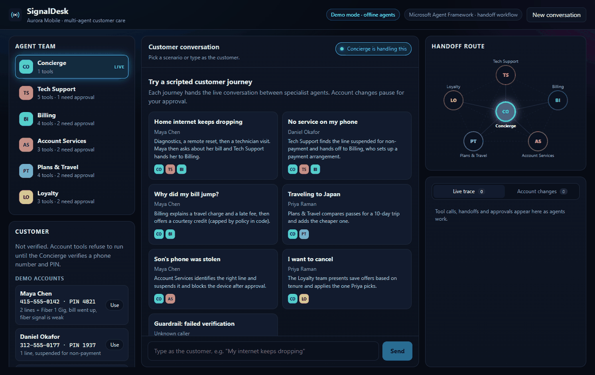
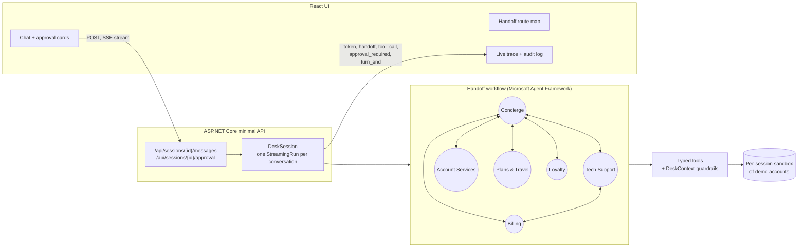
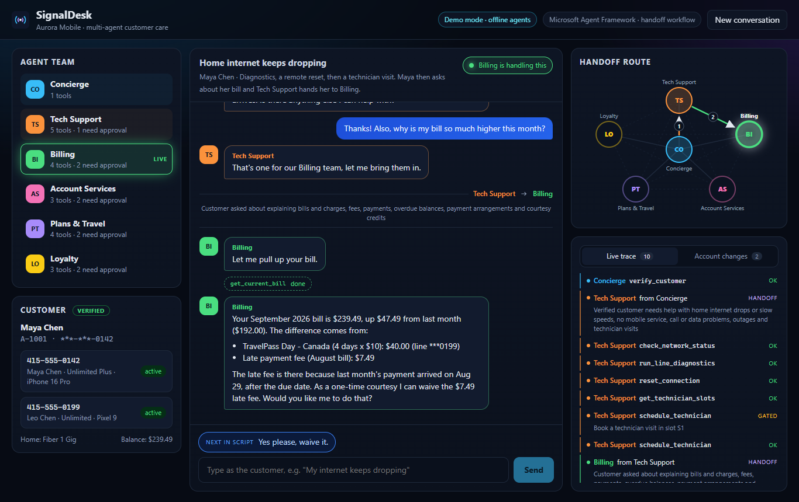
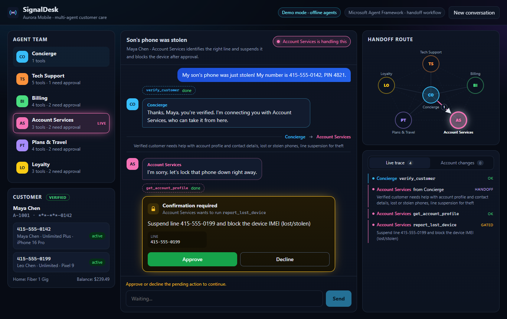
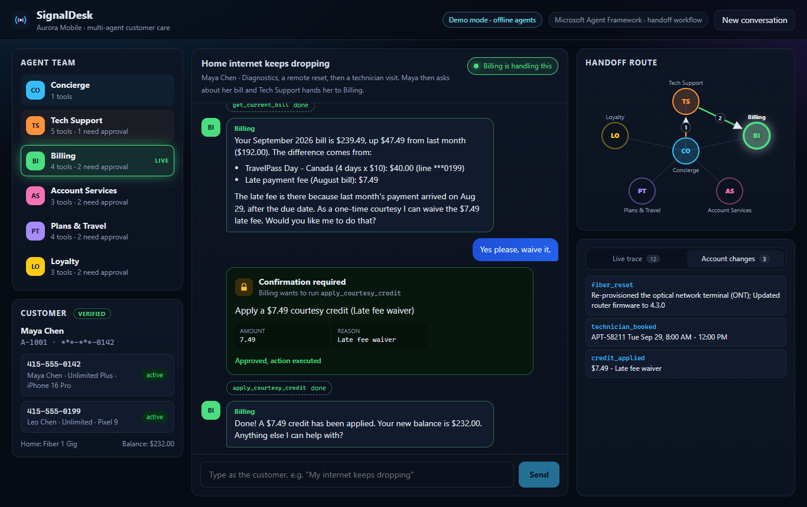

# SignalDesk: multi-agent customer care for a telecom

[](https://github.com/binodsapkota/signaldesk/actions/workflows/ci.yml)


SignalDesk is a customer-care desk for **Aurora Mobile**, a fictional mobile and home-fiber provider. Six AI agents
share a single conversation and **hand it off to each other**, the way a real call center transfers a caller:

- The **Concierge** verifies the caller.
- **Tech Support** runs line diagnostics.
- **Billing** explains a surprise charge.
- **Account Services** blocks a stolen phone.
- **Plans & Travel** sells a roaming pass.
- **Loyalty** tries to save a cancellation.

Anything that changes the account pauses for a human to approve it.

It's built on the **handoff (swarm) orchestration in [Microsoft Agent Framework](https://github.com/microsoft/agent-framework)**.
The backend is an ASP.NET Core API streaming server-sent events, and the frontend is React. It runs **fully offline
out of the box**: deterministic demo agents drive the real framework loop (tool calls, approvals, handoffs). One
environment variable switches the same workflow to a real LLM.



## What to look at

| If you care about... | Look at |
|---|---|
| Multi-agent orchestration | [`DeskWorkflowFactory.cs`](src/SignalDesk.Core/Agents/DeskWorkflowFactory.cs): six agents, all-pairs handoffs, return-to-previous |
| Human-in-the-loop | Mutating tools are wrapped in `ApprovalRequiredAIFunction`; the run pauses on a `RequestInfoEvent` until the UI approves or declines ([`DeskSession.cs`](src/SignalDesk.Core/Runtime/DeskSession.cs)) |
| Guardrails in code, not prompts | [`DeskContext.cs`](src/SignalDesk.Core/Tools/DeskContext.cs), [`BillingTools.cs`](src/SignalDesk.Core/Tools/BillingTools.cs): identity gate, lockout, credit caps |
| Evaluation | [`evals/golden.json`](evals/golden.json): 19 multi-turn cases scored on routing, tool recall, guardrails and task success. CI fails below the thresholds |
| Streaming UX | Token streaming, live handoff route map, tool trace and audit log ([`frontend/src`](frontend/src)) |

## The agent team

| Agent | Handles | Tools (**bold** = needs human approval) |
|---|---|---|
| Concierge | Greeting, identity verification, routing, FAQs | `verify_customer` |
| Tech Support | Home internet drops, no service, outages, technician visits | `check_network_status`, `run_line_diagnostics`, `reset_connection`, `get_technician_slots`, **`schedule_technician`** |
| Billing | Bill explanations, late fees, courtesy credits, payment arrangements | `get_current_bill`, `get_payment_history`, **`apply_courtesy_credit`**, **`set_payment_arrangement`** |
| Account Services | Profile, lost or stolen devices, contact details | `get_account_profile`, **`report_lost_device`**, **`update_contact_email`** |
| Plans & Travel | Plan changes, international roaming passes | `list_plans`, `get_travel_options`, **`add_international_pass`**, **`change_plan`** |
| Loyalty | Cancellations and retention offers | `get_retention_offers`, **`apply_retention_offer`**, **`schedule_cancellation`** |

Every agent can hand off to every other agent. The framework exposes each handoff as a tool the model can call. With
`EnableReturnToPrevious()`, the customer's next message goes straight to whoever spoke last, so a specialist keeps
the conversation until the topic changes.

## Architecture



Only one specialist-to-specialist edge is drawn to keep the diagram readable; in the code every pair is connected.
[`docs/architecture.md`](docs/architecture.md) walks through a full turn, including how framework events map to UI events.

## Guardrails live in code

The prompts ask agents to behave, but the tools **enforce** the rules. A model that ignores its instructions
still can't break them:

- **Identity gate.** Every account tool checks `DeskContext` and refuses until `verify_customer` succeeds.
  A verified session can't switch to a different account.
- **Lockout.** Three wrong PINs lock the session.
- **Money limits.**
  - Courtesy credits are capped at $25 per 12 months per account.
  - Payment arrangements need at least 25% down, with 1–3 installments.
- **Human approval.** Mutating tools (technician dispatch, credits, device blocking, plan changes, cancellations)
  run only after an explicit approve. Declines are returned to the agent, and the agent must acknowledge that
  nothing changed.
- **Redaction.** PINs and full phone numbers never appear in streamed events or the trace; a test asserts this.
- **Loop protection.**
  - Each turn allows at most 6 handoffs; past that, the run resets to the Concierge instead of ping-ponging.
  - Each conversation gets its own sandbox copy of the demo data.
  - The API rate-limits turns per client.

## Evaluation

`evals/golden.json` holds 19 multi-turn conversations covering these areas:

- routing
- topic switches
- approvals and declines
- policy caps
- lockout
- refusals before verification

Each case checks four things:

- the exact agent path (for example `concierge > tech_support > billing`)
- the tools that must and must not run
- the audit entries that must and must not be written
- that the task completed

```bash
dotnet run --project evals/SignalDesk.Evals                    # offline demo agents
dotnet run --project evals/SignalDesk.Evals -- --live          # same cases against a real model (needs OPENAI_API_KEY)
dotnet run --project evals/SignalDesk.Evals -- --trace japan-trip   # print every event for one case
```

| Metric | Demo agents |
|---|---|
| Routing accuracy (exact agent path) | 100% |
| Tool-call recall | 100% |
| Guardrail adherence | 100% |
| Task success | 100% |
| Cases passed | 19/19 |

CI runs the suite on every push and fails if routing or task success drops below 90%, or if any guardrail case fails.
The results table is published to the GitHub Actions job summary. The demo agents are deterministic, so a perfect
score there shows the orchestration, tools and guardrails are wired correctly. The `--live` run is the one that
measures an actual model.

## Run it

### Docker (one command)

```bash
docker compose up --build
```

Open http://localhost:8080 and pick a scripted journey, or type as the customer.
Demo credentials are shown in the sidebar (for example 415-555-0142, PIN 4821).

### Local development

Requires the .NET 10 SDK and Node 22+.

```bash
dotnet run --project src/SignalDesk.Api        # API on http://localhost:5080
cd frontend && npm install && npm run dev      # UI on http://localhost:5173 (proxies /api)
```

```bash
dotnet test                                    # 60 unit, workflow and API tests
```

### Use a real model

The demo agents are there so anyone can clone and run the project without a key. To run the same workflow on an
LLM, set the mode and key. Any OpenAI-compatible endpoint works, including Azure AI Foundry, Ollama and LM Studio.

```bash
cp .env.example .env        # then fill in OPENAI_API_KEY (and optionally OPENAI_MODEL / OPENAI_BASE_URL)
docker compose up --build
```

For local runs, set `SignalDesk__Mode=openai` and `SignalDesk__OpenAIApiKey=...` (or `OPENAI_API_KEY`).
In live mode each agent gets its full instructions from [`AgentRoster.cs`](src/SignalDesk.Core/Agents/AgentRoster.cs).
The tools, guardrails, approvals and handoff wiring are identical.

## Scripted journeys

| Journey | Route |
|---|---|
| Home internet keeps dropping | Concierge → Tech Support (diagnostics, reset, technician booking) → Billing (late-fee waiver) |
| No service on my phone | Concierge → Tech Support finds a line suspended for non-payment → Billing sets up a payment arrangement |
| Why did my bill jump? | Concierge → Billing explains a roaming charge and late fee, offers a capped courtesy credit |
| Traveling to Japan | Concierge → Plans & Travel recommends and adds a roaming pass |
| Son's phone was stolen | Concierge → Account Services finds the right line and blocks the device |
| I want to cancel | Concierge → Loyalty presents save offers based on tenure and applies the one the customer picks |
| Failed verification | A caller without the PIN never reaches a specialist or an account tool |



<details>
<summary>More screenshots</summary>





</details>

## API

| Method | Path | Notes |
|---|---|---|
| `GET` | `/api/health` | Mode and model in use |
| `GET` | `/api/agents` | Agents, scopes and tools (with approval flags) |
| `GET` | `/api/scenarios` | Scripted journeys and demo credentials |
| `POST` | `/api/sessions` | Start a conversation |
| `GET` | `/api/sessions/{id}` | Transcript, active agent, route, pending approval, audit |
| `POST` | `/api/sessions/{id}/messages` | `{ "text": "..." }` → SSE stream of `token`, `message`, `handoff`, `tool_call`, `tool_result`, `approval_required`, `turn_end`, `error` |
| `POST` | `/api/sessions/{id}/approval` | `{ "requestId": "...", "approved": true }` → resumes the paused run as an SSE stream |

## Project layout

```
src/SignalDesk.Core      agents, handoff workflow, tools, guardrails, demo agents, session runtime
src/SignalDesk.Api       minimal API + server-sent events
tests/SignalDesk.Tests   xUnit: tools, intents, end-to-end workflow, HTTP API
evals/                   golden conversations + eval runner used in CI
frontend/                React 19 + Vite + TypeScript UI
```

## Design notes

- **Why handoff instead of a supervisor?** Customer care is a conversation with a single owner at a time. With a
  handoff workflow, the specialist talks to the customer directly and keeps the floor across turns. A supervisor
  would have to re-route every message. The trade-off is that routing mistakes are made by the agents themselves,
  so the evals score the exact agent path.
- **Offline demo agents use the real framework.** Each demo agent is an `IChatClient` that emits text,
  function calls or handoff calls. Everything else is Microsoft Agent Framework as-is: function invocation,
  approval requests, handoff routing and streaming. That's why the tests and evals exercise the real
  orchestration, not a mock of it.
- **One long-lived run per conversation.** `DeskSession` keeps a `StreamingRun` open between turns, so approvals
  resume the paused run instead of replaying history.
- **Honest limits.**
  - Sessions live in memory.
  - The account data is a seeded sandbox.
  - There's no real authentication beyond the demo PIN check.
  - This is a showcase of orchestration and guardrails, not a production contact-center platform.

## License

[MIT](LICENSE) © Binod Sapkota
