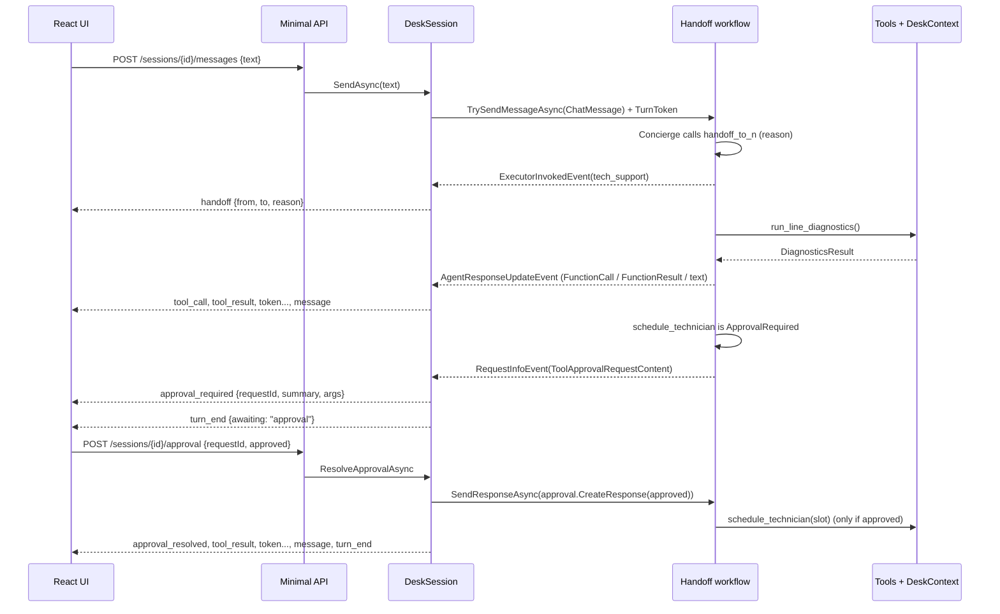

# Architecture

SignalDesk has three layers:

1. A **handoff workflow** of six `ChatClientAgent`s built with Microsoft Agent Framework.
2. A **session runtime** that keeps one workflow run alive per conversation and turns framework events into a small,
   UI-friendly event stream.
3. A **React client** that renders the stream.

## The workflow

[`DeskWorkflowFactory`](../src/SignalDesk.Core/Agents/DeskWorkflowFactory.cs) builds a new workflow for each
conversation:

```csharp
var builder = AgentWorkflowBuilder.CreateHandoffBuilderWith(concierge);
foreach (var from in agents)
    foreach (var to in agents.Where(a => a != from))
        builder = builder.WithHandoff(from, to, AgentRoster.HandoffReason(to));
return builder.EnableReturnToPrevious().Build();
```

- **Start agent.** The Concierge receives the first message of every conversation.
- **Handoff tools.** Each `WithHandoff` edge becomes a tool on the source agent. The tool description is the
  handoff reason, for example *"Transfer to Billing (billing): bill explanations, fees, payments…"*, so the model
  routes by reading the tool list.
- **Return to previous.** The customer's next message goes to whichever agent answered last. A specialist keeps the
  conversation until it (or the customer) changes topic.
- **Per-conversation state.** Tools are created per conversation over a `DeskContext`. The context holds the
  verified customer, the failed-attempt counter and the audit log, and it points at a private copy of the demo
  accounts.

## One turn, end to end



`DeskSession` holds one `StreamingRun` for the lifetime of the conversation and watches it with
`WatchStreamAsync(blockOnPendingRequest: false)`. A turn ends in one of two ways:

- **Idle.** The workflow goes idle, and the session emits `turn_end` with `awaiting: "customer"`.
- **Paused for approval.** The workflow pauses on an approval request. The session then rejects new customer
  messages (HTTP 409) until the approval is resolved.

A per-session semaphore makes turns strictly sequential.

## Event mapping

| Framework event | SignalDesk event | Notes |
|---|---|---|
| `ExecutorInvokedEvent` for a different agent | `handoff` | The reason comes from the `handoff_to_*` call's `reasonForHandoff` argument |
| `AgentResponseUpdateEvent` with `TextContent` | `token`, then `message` | Tokens are buffered per agent and flushed as a full message |
| `AgentResponseUpdateEvent` with `FunctionCallContent` | `tool_call` | Arguments pass through `Redaction.MaskArgs` (PINs and phone numbers masked) |
| `AgentResponseUpdateEvent` with `FunctionResultContent` | `tool_result` | `ok` is derived from the result (`error`, `rejected`, or a false success flag) |
| `RequestInfoEvent` with `ToolApprovalRequestContent` | `approval_required` | Carries a human-readable summary from `Redaction.DescribeApproval` |
| `WorkflowErrorEvent`, `ExecutorFailedEvent` | `error` | |
| end of turn | `turn_end` | Active agent, route so far, customer snapshot, audit log |

## Demo mode

Demo mode lets the project run and be tested without an API key while still exercising the real orchestration.
[`DemoChatClient`](../src/SignalDesk.Core/Demo/DemoChatClient.cs) is an `IChatClient`, and each agent gets one. It
reads the conversation the framework passes in and asks a per-agent "brain" what to do next:

- **Say something.** The client streams the text word by word.
- **Call a tool.** It emits a `FunctionCallContent`, and the framework's function-invocation layer runs the real
  tool, applies approval gating and feeds the result back.
- **Hand off.** It calls the `handoff_to_*` tool whose description names the target agent.

Most of the brains' logic is in [`Transcript`](../src/SignalDesk.Core/Demo/Transcript.cs), which interprets the
conversation from an agent's point of view.

One framework detail matters here. When a conversation is handed off, earlier replies from other agents are passed
to the next agent as user-role messages tagged with an `AuthorName`. `Transcript.IsCustomer` filters those out, so
an agent never mistakes a colleague's words for the customer's.

## Failure handling

- **Routing loops.**
  - More than `MaxHandoffsPerTurn` handoffs (default 6) in a single turn disposes the run.
  - The session then resets to the Concierge and tells the customer a human has been notified.
- **Tool errors.** Tools return `ToolError` records instead of throwing, so the agent can explain the refusal
  (for example "verify the caller first" or "that exceeds the $25 courtesy-credit limit").
- **Stream errors.** The API's SSE wrapper converts any exception during a turn into a final `error` event, so
  the client never hangs.
